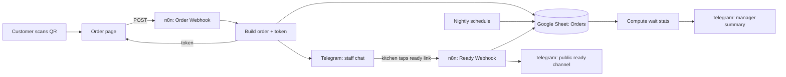

# Blue Dove: QR Order and Ready-Board System

A low-cost, no-download ordering layer for a busy food counter, built with **n8n**, **Google Sheets** and **Telegram**. Customers scan a QR code, browse a described menu on their own phone, place an order, and get a token number. The kitchen is alerted automatically, ready orders are announced on a Telegram board, and every order is time-stamped so management gets measured wait data.

Built as the "New Age Technology" component of a Service Operations Management consulting project on queue-to-order friction at a campus food counter.

> **Status:** working prototype on free tiers. The order, logging and kitchen-alert loop has been tested. See [Limitations](#limitations) and [Roadmap](#roadmap).

## Problem

Consulting research (customer survey, interviews, staff input) pointed to two frictions at the counter:

1. **Decision friction:** customers decide what to order while standing at the counter, which slows the queue.
2. **Missed ticket calls:** order numbers called aloud get lost in a noisy space.

Cooking time is a separate bottleneck that this system does not change. It targets decision friction and perceived waiting, not food preparation.

## Solution

| Component | What it does | Problem it targets |
|---|---|---|
| QR order page | Menu with descriptions, diet and spice labels; cart; token number on confirmation | Decision friction, counter queue |
| Kitchen alert | New order pushed to a staff Telegram chat with a one-tap "ready" link | Order handoff |
| Ready board | Token posted to a public Telegram channel when the order is ready | Missed ticket calls |
| Timestamp log | Every order stored with placed and ready times in Google Sheets | No measured baseline |
| Daily summary | Nightly average and max wait by hour sent to the manager | Management visibility |
| Menu assistant (optional) | n8n AI Agent that answers menu questions from the Menu sheet only | Decision friction |

## Architecture



Three workflows live in one n8n file:

1. **Order intake:** Order Webhook, Build Order (code), Log Order (Sheets), Notify Kitchen (Telegram), Reply With Token.
2. **Ready board:** Ready Webhook, Mark Ready In Sheet, Post To Ready Board (Telegram), Confirm To Kitchen.
3. **Daily summary:** Schedule trigger, Read Orders (Sheets), Compute Wait Stats (code), Send Summary (Telegram).

## Repository layout

```
web/index.html                      Mobile-first order page (single file, no framework)
workflow/bluedove_workflow.json     Importable n8n workflow (secrets removed)
data/menu.csv                       Sample menu (replace with the real one)
docs/SETUP.md                       Step-by-step setup and troubleshooting
docs/MENU_ASSISTANT.md              Agent prompt and test cases
```

## Quick start

Full steps are in [docs/SETUP.md](docs/SETUP.md). In short:

1. Create a Google Sheet with an `Orders` tab (headers below) and a `Menu` tab (import `data/menu.csv`).
2. Create a Telegram bot with @BotFather, a **private staff group**, and a **public broadcast channel** for the ready board.
3. Import `workflow/bluedove_workflow.json` into n8n, attach credentials, replace every `YOUR_...` placeholder, then publish.
4. Set `ORDER_URL` (and `TELEGRAM_URL`) in `web/index.html`, host it on any static host, and turn the link into a QR code.

`Orders` headers: `order_id, token, placed_at, placed_hour_ist, customer, items, total, status, ready_at`

## Design decisions

- **Deterministic core, AI at the edge.** Ordering, logging and alerts are plain workflow nodes so they behave predictably at a rush. The AI agent only answers menu questions, with a menu-only system prompt and explicit refusal and allergy-deferral rules.
- **No app, no account.** The page is one static file opened from a QR code.
- **Data minimisation.** Only an optional first name is collected. No payment data is handled.
- **Staff chat and public board are separate.** Kitchen alerts contain order details and ready links, so they stay in a private chat.

## Limitations

- Payment is intentionally out of scope. In the consulting recommendation, ordering and payment stay at the counter during the pilot.
- Telegram is a prototype channel. Customers without it still see their token on screen. WhatsApp Business API is the production path but needs approved message templates.
- The webhook is unauthenticated. Anyone with the link can submit an order, which can exhaust free-tier execution limits. Add a shared-secret header or rate limiting before real use.
- n8n Cloud trials are time-limited, and webhooks stop when a trial ends.
- Staff must tap the ready link for every order, so the board is only as accurate as that habit.

## Roadmap

- Browse-only mode for a menu-only pilot, with online ordering as a later phase
- Webhook authentication and basic abuse protection
- Live kitchen and manager dashboard reading the Orders sheet
- Online payment in a gateway test mode, with server-side signature verification
- Per-customer ready alerts via WhatsApp Business API

## Tech stack

n8n, Google Sheets API, Telegram Bot API, HTML/CSS/JavaScript, static hosting.

## Troubleshooting notes (lessons learned)

- A browser address bar sends GET, and the order webhook accepts POST only.
- Use the n8n **Production** URL (`/webhook/`), not the Test URL, and publish the workflow.
- "The resource you are requesting could not be found" on a Sheets node means the connected Google account cannot see that file.
- After changing a Sheets document, refresh the columns and use **Map Automatically** for append. On **append or update**, send only the match column and the fields you change, or empty fields overwrite existing data.
- Never publish bot tokens. If one leaks, revoke it with @BotFather.

## License

MIT. See [LICENSE](LICENSE).
